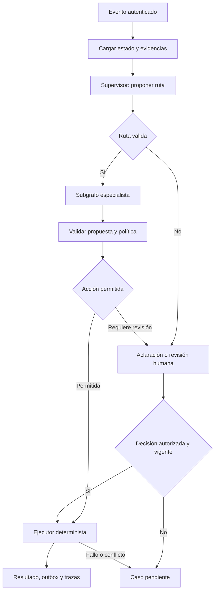
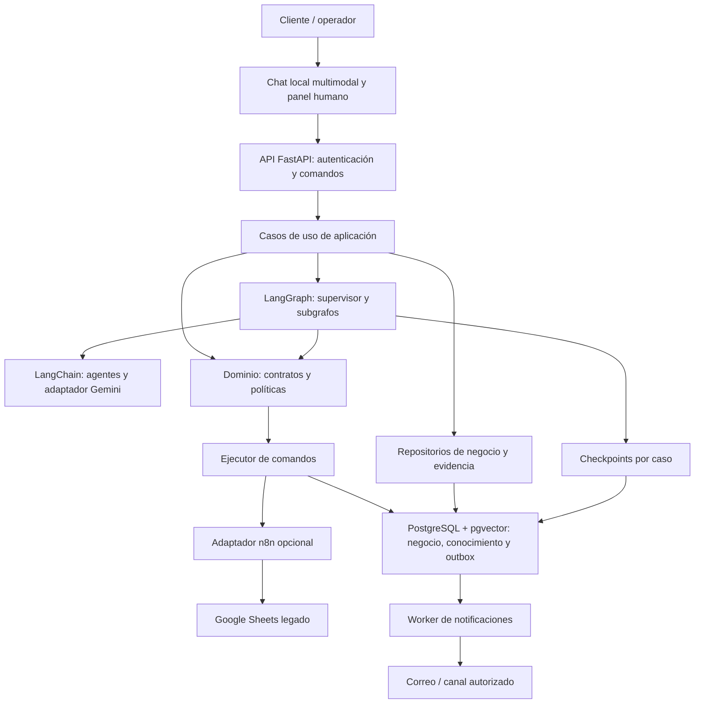

> Este documento conserva la especificación 1.2 de entrada. La implementación y sus comprobaciones actuales se describen en [arquitectura implementada](arquitectura/IMPLEMENTADA.md) y [resultados del producto](validacion/PRODUCTO_V1.md).

# Plan de arquitectura de Aqua Clean S.A.C.

**Versión:** 1.2. **Fecha:** 14/10/2026. **Alcance:** procesos y arquitectura para implementar una V1 local dockerizada con chat multimodal, Gemini, LangChain, LangGraph y PostgreSQL + pgvector. Esta versión incorpora las indicaciones adicionales del aula; todavía no contiene una aplicación ejecutada.

## 1. Decisión de alcance y hallazgos de los insumos

Se propone una aplicación modular para gestionar el pedido de lavandería de clientes corporativos y sus excepciones. Integra cuatro capacidades de razonamiento: interpretar solicitudes, coordinar alternativas de agenda, analizar observaciones de calidad e investigar reclamos. Conserva la operación física en manos de choferes y personal de planta. El registro y las reglas administrativas se ejecutan mediante servicios deterministas.

Esta decisión mantiene la continuidad con `proceso-lavanderia-as-is.bpmn`, `proceso-recojo-to-be.bpmn` y los flujos n8n entregados, que usan el nombre Aqua Clean y un padrón de clientes corporativos. El nombre se toma de esos modelos; no se considera una razón social verificada externamente.

| Hallazgo | Implicación para el diseño | Acción documental o técnica |
|---|---|---|
| Laboratorio 01 escoge atención al detalle y excluye clientes institucionales; BPMN y n8n trabajan con corporativos | Hay dos alcances distintos en el expediente | Ratificar el alcance corporativo y actualizar acta, selección y muestreo; conservar el original para trazabilidad |
| Línea base del Laboratorio 01: 618 órdenes al detalle por mes y 18 casos muestreados | No demuestra tiempos ni beneficios del flujo corporativo | Medir solicitudes, agendas, calidad y reclamos corporativos antes de calcular ahorro |
| Laboratorio 02 menciona 260 registros mensuales para el subproceso de recojo | Es una cifra documental de otro alcance; no equivale a la muestra del Laboratorio 01 | Verificar período, registro y evidencia corporativos |
| AS IS anota espera de 6,4 h y eficiencia de 4,1 % | No se encontró una muestra corporativa que permita reconciliar esa anotación con el Excel | Retirar esa anotación en la copia revisada y dejar línea base corporativa pendiente |
| La matriz anterior considera reclamos no viables por datos inaccesibles | El razonamiento de un agente no produce evidencia que no existe | P4 requiere captura de expedientes y comienza en modo supervisado |
| n8n incorpora coordinador, registrador y subflujo determinista | El registrador actúa principalmente como envoltorio de una herramienta | Reutilizar `registrar_recojo` como servicio; asignar agentes a responsabilidades que sí necesitan interpretación |
| Los prompts n8n exigen siete campos y el Excel también enumera siete obligatorios | La documentación de «seis campos» corresponde a la entrada de la cola de fallidos | Distinguir contrato del pedido, contrato de resultado y contrato de error |
| La búsqueda seguida de append en una hoja no constituye una escritura atómica | Dos solicitudes simultáneas pueden superar la búsqueda previa | Añadir restricción única y transacción en el servicio Python; mantener prueba concurrente del adaptador n8n |

No se han inventado entrevistas, métricas de mejora, probabilidades calibradas, expedientes, tarifas ni políticas de la empresa. Las características nuevas se describen como propuestas TO BE y los límites numéricos del piloto son configurables.

## 2. Qué se adapta de la sesión 6

El PDF plantea un catálogo TO BE, un orquestador, especialistas por dominio, conocimiento recuperado, decisiones tipadas, revisión humana por riesgo y trazabilidad. Su versión 2 distingue la capa de decisión de la política de autorización. Esta separación se conserva.

Para la lavandería se propone **un supervisor y cuatro especialistas**, no los diecinueve agentes del ejemplo académico. Se usa un almacén lógico por organización y controles por cliente/caso. No hacen falta almacenes por carrera ni entrenamiento QLoRA. Tampoco se trasladan a Aqua Clean las cifras de evaluación ni los tiempos del ejemplo.

La revisión visual del video compartido confirma la metodología de partir del catálogo BPMN, documentar invariantes en el repositorio, construir módulos, probar excepciones/HITL y demostrar una interfaz. Se adapta su preparación del repositorio a `AGENTS.md` para Codex, con contratos, lectura previa de los modelos y verificaciones por fase. No se reproducen sus archivos específicos de Claude Code ni se presupone que sus servicios AWS formen parte del alcance de la lavandería. La revisión del video fue visual mediante 24 muestras; no se transcribió su audio.

La práctica del PDF solicita un video del desarrollo hasta la implementación en código. El paquete actual prepara ese desarrollo; no reemplaza la aplicación ni el video. La fecha indicada en la sesión es sábado 17/10/2026 a las 20:00. Confirmar el plazo en Canvas antes de entregar.

VS Code es el editor, Codex el asistente de desarrollo y Python el lenguaje de la aplicación. Codex no es uno de los agentes que atenderá pedidos en producción. El proveedor de LLM de la aplicación se configura por adaptador; se puede conservar Gemini para mantener continuidad con n8n, si su cuenta y el modelo elegido soportan las herramientas y los esquemas requeridos.

## 3. Procesos seleccionados y naturaleza de sus decisiones

| Proceso | Decisión contextual que justifica LLM | Cálculos y acciones deterministas | Responsable final |
|---|---|---|---|
| P1. Interpretar y registrar solicitudes | Comprender mensajes incompletos, referencias de fecha y correcciones; elegir qué aclarar | Autenticación, padrón, siete campos, fecha válida, deduplicación y registro | Asesor para ambigüedad; administración para bloqueo comercial |
| P2. Coordinar recojos y entregas | Interpretar urgencia, preferencias y contrapropuestas, explicar alternativas factibles | Horarios, capacidad, disponibilidad, restricciones, reserva atómica | Responsable de logística para cambios fuera de política |
| P3. Analizar observaciones de calidad | Contrastar descripciones e historial con procedimientos y justificar una disposición | Conteos, trazabilidad, reglas de incompatibilidad, registro de disposición | Personal de control de calidad valida físicamente y autoriza |
| P4. Investigar reclamos e incidencias | Reconstruir hechos contradictorios y formular alternativas sustentadas | Expediente, autorizaciones, costos obtenidos del sistema, ejecución y cierre | Administración aprueba solución y verifica cumplimiento |

«No determinista» aquí significa que el contexto requiere interpretación y que una propuesta del modelo puede variar. No implica ausencia de reglas ni autorización libre. Cada salida tiene un esquema, evidencias verificables y condiciones de aceptación.

El cálculo de una ruta óptima, una fecha o un precio no se vuelve agentic por ejecutarlo con un LLM. En P2, las opciones se calculan mediante reglas o un optimizador; el agente interpreta preferencias, negocia y explica. En P3 no se automatizan máquinas, dosificaciones ni la evaluación física de seguridad. En P4 el agente no adjudica responsabilidad ni autoriza compensaciones.

## 4. Arquitectura multiagente

### 4.1 Patrón de coordinación

Se usa un supervisor con estado compartido acotado y cuatro subgrafos especializados. El supervisor interpreta el objetivo, solicita una ruta tipada y delega al especialista correspondiente. Una función determinista valida esa ruta contra el evento recibido, las competencias y los permisos. Cuando la intención es ambigua, se pide aclaración o se deriva; no se prueban todos los agentes indiscriminadamente.

Los especialistas devuelven propuestas al supervisor. No transfieren el control entre ellos mediante conversaciones abiertas. Si P3 abre una incidencia, publica un evento de dominio y la aplicación inicia P4 con el expediente correspondiente. Se conserva el identificador del pedido y se usa un caso separado para la incidencia. Si una solución exige una entrega, se inicia P2 con la orden autorizada. Esto hace visibles las dependencias y permite reiniciar cada caso sin repetir acciones previas.

| Agente | Entrada mínima | Conocimiento permitido | Herramientas de lectura | Salida y límites |
|---|---|---|---|---|
| Supervisor | Evento autenticado, contexto del caso y fase del pedido | Catálogo de procesos y competencias | Estado del caso y acciones disponibles | `RoutingDecision`; delega y consolida. No escribe pedidos ni cambia deudas |
| Atención | Mensaje y referencia de cliente autenticada | Esquema del pedido, canales y preguntas de aclaración | Padrón filtrado y pedido existente | `RequestDraft`; cita texto extraído, confirma datos y propone registro |
| Logística | Pedido, incidente y preferencias del cliente | Horarios y procedimientos de coordinación vigentes | Agenda y herramienta de opciones factibles | `ScheduleProposal`; usa IDs de opciones calculadas y no promete cupos |
| Calidad | Guía y observaciones capturadas por planta | Procedimientos y criterios aprobados de calidad | Evidencias e historial del lote | `QualityRecommendation`; diferencia hechos de hipótesis; requiere validación física |
| Incidencias | Caso, reclamo y evidencias autorizadas | Contrato y política vigente de atención de reclamos | Guías, comunicaciones e historial del caso | `ResolutionProposal`; formula alternativas, no concede compensaciones |

Cada especialista implementa modelo, instrucciones, herramientas y contrato de salida propios. Compartir el proveedor o incluso el mismo modelo no elimina la separación de responsabilidades. Un nombre distinto con el mismo prompt y los mismos permisos no sería una especialización suficiente.

### 4.2 Grafo de ejecución y política



El diagrama técnico BPMN `06` representa esta coordinación. El integral `01` representa el negocio. El catálogo de responsabilidades es común, pero estos niveles se mantienen separados.

### 4.3 Estado, memoria y conocimiento

`CaseState` contiene `organization_id`, `case_id`, `order_id`, `client_id`, `event_id`, `process_type`, `phase`, `messages`, `facts`, `evidence_refs`, `proposal`, `missing_fields`, `risk_reasons`, `approval_ref`, `policy_version`, `record_version`, `tool_results`, `clarification_count`, `retry_count`, `next_action` y `status`.

Los campos de identidad y organización proceden del contexto de sesión establecido en el servidor: actor fijo y datos sintéticos en demo local, o identidad autenticada en un perfil real. No se aceptan como autoridad por haberlos generado un LLM. `facts` incluye origen y fecha. `proposal` nunca sustituye al resultado de una herramienta. Los historiales largos se resumen con referencias y se recupera únicamente la evidencia necesaria.

Se utiliza un `thread_id` estable generado por la aplicación para cada caso, por ejemplo `org:<id>:case:<id>`. Los checkpoints conservan el progreso del grafo y permiten reanudar una revisión. Los datos de negocio se guardan en tablas propias y constituyen la fuente de verdad. La persistencia de LangGraph no reemplaza el registro de pedidos ni garantiza por sí sola una escritura única en una hoja.

El conocimiento de largo plazo reúne políticas aprobadas, contratos y procedimientos versionados. **La base vectorial es obligatoria desde la V1:** PostgreSQL con extensión pgvector, documentos fragmentados, embeddings reales y búsqueda por similitud filtrada por permisos y vigencia detrás de `KnowledgeRepository`. La búsqueda textual puede complementar la vectorial, pero no sustituirla en la entrega. Los pedidos, mensajes y checkpoints conservan sus tablas propias. No crear una base diferente por agente.

Cada fragmento recuperado lleva `document_id`, `version`, `section`, `organization_id`, `valid_from` y `hash`. Se filtra por organización, cliente cuando corresponda y vigencia. Una comunicación de un cliente es evidencia del caso; no se indexa automáticamente como política de la empresa. Los adjuntos y mensajes son datos, no instrucciones para cambiar herramientas o permisos.

### 4.4 Autorización, incertidumbre y HITL

En el piloto se decide por condiciones verificables: identidad resuelta, campos completos, evidencia disponible, restricciones satisfechas, permisos y riesgo. No se convierte un «95 % de confianza» autodeclarado por un LLM en una probabilidad calibrada.

| Acción | Política inicial propuesta |
|---|---|
| Leer datos del propio caso, solicitar un dato y mostrar alternativas válidas | Automática tras controles de acceso |
| Registrar pedido normal | Requiere confirmación explícita del cliente y habilitación comercial verificadas |
| Reservar una opción dentro de agenda y contrato | Requiere selección del cliente y revalidación atómica de capacidad |
| Atender cliente bloqueado, sobrepasar plazo o modificar compromiso fuera de política | Aprobación del responsable correspondiente |
| Reprocesar, liberar lote observado o resolver duda sobre material | Decisión humana de calidad y cumplimiento de procedimientos aprobados |
| Compensar, descontar, atribuir responsabilidad o cerrar un reclamo | Aprobación humana y evidencia de cumplimiento |
| Faltan evidencias, falla el modelo o se agota el límite de aclaración | Estado pendiente y responsable asignado |

Una aprobación se vincula al hash de la propuesta, a la versión del pedido, al usuario aprobador, su rol, organización, fecha y política. Si cambian el monto, la fecha o la evidencia relevante, se invalida la aprobación y se revisa otra vez. El texto del chat del cliente no equivale a autorización administrativa.

LangGraph debe pausar con `interrupt()` y reanudar con `Command(resume=...)` utilizando el mismo `thread_id`. La API valida quién responde y qué propuesta aprueba. Los nodos pueden volver a ejecutarse al reanudar; por eso no deben realizar envíos ni escrituras no idempotentes antes de la pausa. Las operaciones con efectos se concentran en el ejecutor.

Una fase posterior puede entrenar o calibrar clasificación de intención y medir Brier/ECE sobre datos etiquetados, con conjunto de evaluación separado y umbrales por decisión. Esa ampliación necesita muestra suficiente. No se declara implementada ni calibrada en este diseño.

## 5. Arquitectura de software

### 5.1 Monolito modular para el proyecto

Se propone una aplicación Python modular, con API FastAPI, **chat web multimodal en localhost**, panel de revisión y worker. Docker Compose levanta la aplicación, el worker y PostgreSQL + pgvector, con migraciones y volúmenes persistentes. La V1 recibe texto, imágenes, PDF y audio; devuelve respuestas textuales, citas y acciones de negocio verificadas. Gemini es el proveedor inicial configurable. Los agentes comparten backend y se separan por módulos; no se crea un microservicio por agente.

LangChain construye especialistas con herramientas y respuestas estructuradas. LangGraph define estados, rutas, subgrafos, checkpoints e interrupciones. La capa de dominio define contratos y reglas sin depender de LangChain, HTTP o n8n. Los casos de uso de aplicación aplican el orden: cargar, proponer, validar, autorizar, ejecutar y registrar. Solo `infrastructure/llm/provider.py` instancia los modelos; el resto recibe la dependencia configurada y versionada.

### 5.2 Componentes y datos



Se conservan tablas separadas o esquemas de PostgreSQL para negocio, checkpoints y evidencia. Los archivos de evidencia viven en almacenamiento de archivos con referencias y hash; el contenido sensible no se copia entero en trazas. Un mismo pedido puede tener varios casos, por ejemplo solicitud, cambio de agenda y reclamo.

La V1 entregable utiliza PostgreSQL + pgvector y checkpoints persistentes en PostgreSQL desde el inicio. SQLite o respuestas simuladas pueden utilizarse en tests aislados, pero no cumplen el requisito de la demostración local. Se fijan las versiones que hayan pasado pruebas; no se mezclan ejemplos de APIs antiguas y nuevas sin comprobarlos.

### 5.3 Organización del repositorio propuesto

```text
aquaclean/
  AGENTS.md
  pyproject.toml
  uv.lock
  .env.example
  Dockerfile
  compose.yaml
  .dockerignore
  src/aquaclean/
    bootstrap.py
    config.py
    domain/
      entities.py
      commands.py
      events.py
      policies.py
      errors.py
    application/
      ports.py
      cases.py
      approvals.py
      command_executor.py
    agents/
      supervisor.py
      attention.py
      logistics.py
      quality.py
      incidents.py
      schemas.py
      prompts/
    graphs/
      state.py
      main.py
      attention_flow.py
      logistics_flow.py
      quality_flow.py
      incidents_flow.py
      human_review.py
    infrastructure/
      llm/provider.py
      llm/embeddings.py
      media/validation.py
      media/processing.py
      media/storage.py
      persistence/repositories.py
      persistence/checkpointer.py
      knowledge/retrieval.py
      integrations/n8n.py
      integrations/sheets.py
      integrations/notifications.py
      observability/tracing.py
    interfaces/api/
      app.py
      auth.py
      routes/cases.py
      routes/approvals.py
      routes/chat.py
      routes/uploads.py
      routes/knowledge.py
    interfaces/static/  # recursos compilados desde web/
    workers/
      outbox.py
      timeouts.py
  knowledge/
    policies/
    procedures/
    catalog.yaml
  web/
    astro.config.mjs
    package.json
    src/pages/index.astro
    src/components/chat/
    src/components/ui/
    src/hooks/
    src/styles/global.css
  migrations/
  tests/
    unit/
    integration/
    acceptance/
    evaluations/
  docs/
    bpmn/
    adr/
  scripts/
    seed_demo.py
    ingest_knowledge.py
    smoke_local.py
    verify_vector_store.py
    run_demo.py
```

Es una estructura planificada, no archivos de aplicación que ya hayan sido creados y ejecutados. `agents` contiene la construcción de agentes y sus contratos; `graphs` contiene flujo y estado, evitando mezclar prompts con transacciones. `bootstrap` inyecta repositorios, proveedor LLM y adaptadores. `application.ports` define interfaces para que los tests no dependan de credenciales reales.

La dependencia apunta hacia el dominio. Un endpoint no escribe directamente en Google Sheets. Un agente no importa la conexión de base de datos para modificar pedidos. El repositorio no decide cuándo hace falta autorización. Las herramientas que el agente puede invocar son principalmente lecturas y cálculo de alternativas; los comandos con efectos se entregan al ejecutor después de validar la propuesta.

### 5.4 Contratos de entrada y de resultado

Se mantiene el contrato de recojo existente: `cliente_id`, `solicitante`, `correo`, `fecha_recojo`, `turno`, `tipo_ropa` y `bolsas` obligatorios; `direccion_recojo`, `observaciones` y `canal` opcionales. Los enumerados y límites se validan en código. Las fechas relativas se convierten con reloj inyectable y zona `America/Lima`, se muestran como fechas exactas y se confirman antes de registrar.

La dirección de padrón es un valor obtenido del sistema y debe mostrarse al cliente cuando se use. Identificar a alguien por un código `CLI-####` no autentica al remitente. La API o el asesor debe establecer esa relación de forma independiente.

```json
{
  "schema_version": "1.0",
  "case_id": "CASE-DEMO-001",
  "decision_type": "schedule_proposal",
  "option_ids": ["OPTION-DEMO-01"],
  "evidence_refs": ["AGENDA-DEMO:v3", "POLICY-DEMO:v1:4"],
  "missing_fields": [],
  "risk_reasons": ["cambio_fuera_del_turno_original"],
  "recommended_action": "request_human_review",
  "rationale_summary": "La alternativa respeta capacidad y requiere revisar el cambio de compromiso."
}
```

El JSON anterior es un ejemplo sintético de esquema. No es una agenda ni una política real. El servidor añade organización, identidad y versiones confiables. `rationale_summary` resume razones y evidencia observables; no solicita ni conserva una cadena privada de pensamiento del modelo.

| Contrato | Campos clave | Invariante |
|---|---|---|
| `RoutingDecision` | `process_type`, `reason_code`, `evidence_refs`, `needs_clarification` | Dominio permitido por la fase del caso |
| `RequestDraft` | Siete campos, `field_sources`, `missing_fields`, `confirmed_fields` | Ningún obligatorio inferido sin evidencia/confirmación |
| `ScheduleProposal` | `option_ids`, preferencias, restricciones y versiones | Toda opción existe en la respuesta del calculador |
| `QualityRecommendation` | Hallazgos, hipótesis, procedimiento y disposición propuesta | Sin parámetros químicos inventados; liberación requiere control humano |
| `ResolutionProposal` | Hechos, discrepancias, alternativas y evidencia | Sin compensación autorizada por el LLM |
| `ApprovalDecision` | Usuario, rol, hash, versión y decisión | Actor habilitado y propuesta vigente |
| `CommandResult` | `command_id`, `status`, IDs, versión y efectos | Comunica hechos persistidos, no lo que el agente esperaba |

La compatibilidad n8n preserva `status = registrado|ya_registrado|derivado|rechazado|error_sistema` y `numero_pedido`, `clave`, `salida_ruta`, `reprogramado`, `motivo`. Un resultado `derivado` no se comunica como recojo confirmado. Un `error_sistema` no implica que el pedido haya sido creado ni que sea seguro duplicarlo.

### 5.5 Transacciones, idempotencia y notificación

El subflujo original genera una clave a partir del contenido de negocio. Esa regla se conserva en el adaptador legado mientras se valida su comportamiento. Sin embargo, dos pedidos intencionalmente distintos con igual contenido pueden compartirla. El diseño nuevo separa un identificador de solicitud estable, el hash de contenido para detectar reenvíos y un `command_id` para cada acción. El cliente o la API conserva el identificador entre reintentos; una nueva solicitud confirmada recibe otro identificador aunque sus datos coincidan.

El servicio Python usa una restricción única sobre organización y clave de solicitud/acción, valida `record_version` y actualiza pedido, registro de comando y outbox en una transacción. La búsqueda previa sirve para responder rápido; la restricción de base de datos resuelve la carrera concurrente. Si llega una solicitud con el mismo identificador y contenido diferente, se rechaza por conflicto o se tramita como cambio explícito.

Google Sheets se mantiene como integración de compatibilidad o vista sincronizada. No se usan al mismo tiempo Sheets y PostgreSQL como dos autoridades de escritura. Elegir por configuración un único backend de pedidos. Durante el puente n8n, no atribuir garantías de atomicidad a la hoja; registrar y probar sus limitaciones. La ruta principal de LangGraph invoca el servicio seleccionado directamente, evitando llamar de nuevo al coordinador n8n con LLM.

La notificación sigue al registro confirmado. Un worker entrega los mensajes de outbox y deduplica por evento. Si se registra el pedido pero falla el correo, el caso queda `registrado_notificacion_pendiente`. Se reintenta el envío, sin crear otro pedido. El identificador del proveedor y su resultado se conservan. No se promete entrega exactamente una vez por un canal que no la soporte.

### 5.6 Recuperación y límites propuestos

| Situación | Comportamiento propuesto |
|---|---|
| Error de esquema o campos incompletos | Pedir datos; no ejecutar comandos |
| Salida LLM inválida | Una solicitud de corrección estructurada; después, revisión humana |
| Evidencia inexistente o documento vencido | Pendiente; registrar qué falta y a quién corresponde aportarlo |
| Fallo transitorio de lectura | Hasta tres intentos totales; esperas de 2 y 4 s entre intentos |
| Fallo de escritura con resultado incierto | Consultar el ledger del mismo `command_id` antes de reintentar |
| Credencial inválida o permiso denegado | Detener la integración y alertar; no reintentar automáticamente |
| Cambio de capacidad o versión | Invalidar propuesta y recalcular; revisión si agota el límite |
| LLM indisponible o presupuesto agotado | Captura estructurada y derivación humana; conservar el estado |
| Espera de respuesta de cliente | 24 h de piloto; expirar por worker y marcar pendiente |

P1 y P2 tienen hasta dos rondas de aclaración/negociación. P3 tiene una solicitud de evidencia y un reproceso físico autorizado como límite del modelo piloto; cualquier nuevo tratamiento requiere nueva evaluación humana. P4 tiene una solicitud adicional de evidencia y una contrapropuesta antes de derivar. Son límites propuestos, no reglas descubiertas en la empresa. `max_steps`, timeout LLM y presupuesto se configuran por ejecución y se prueban sin utilizar los valores de latencia del ejemplo docente.

Los temporizadores BPMN son semántica del proceso. `interrupt()` no instala automáticamente un temporizador: `workers/timeouts.py` registra el vencimiento persistente y publica un evento autenticado para reanudar o derivar el caso. Mientras espera un humano, el servicio libera el worker y conserva el checkpoint.

### 5.7 Acceso, auditoría y observabilidad

Perfiles mínimos: asesor, logística, calidad y administración. Un cliente accede a sus pedidos; un operador solo a las capacidades de su rol. Una llamada a una herramienta vuelve a verificar ese alcance. No se permite cambiar `organization_id` mediante el prompt.

Las credenciales se leen de configuración segura y `.env` excluido del repositorio. Los archivos de prueba son sintéticos. Cada ejecución registra `trace_id`, caso, proceso, versiones de prompt/modelo/política, evidencia citada, herramientas, aprobación, comando y resultado. Se ocultan contactos y contenido sensible en logs. La explicación visible es la lista de hechos, fuentes y razón de la recomendación.

LangSmith puede agregarse para trazas y evaluación si el equipo configura los permisos y qué datos puede transmitir. El MVP debe poder auditarse con registros propios sin depender de ese servicio.

## 6. Secuencia de implementación en VS Code con Codex

| Fase | Trabajo concreto | Evidencia para aceptar |
|---|---|---|
| F0. Alineación | Ratificar corporativos, procedimientos, horarios y responsables; crear corpus mínimo y catálogo de datos | Acta alineada y casos anonimizados/sintéticos separados |
| F1. Dominio | Implementar DTO, reglas, puertos, errores y ledger; congelar contrato de registro | Tests de campos, fechas Lima y duplicados concurrentes |
| F2. Base local y herramientas | Docker Compose, PostgreSQL + pgvector, migraciones, repositorios y corpus; fakes solo en tests | Arranque limpio, volúmenes, embeddings reales y consulta vectorial; resultados `CommandResult` verificables |
| F3. Chat y corte vertical P1 | Chat local multimodal, Gemini configurable, atención/supervisor, grafo, checkpoint y confirmación | Texto/imagen/PDF/audio reales; solicitud incompleta, registro, reenvío y bloqueo |
| F4. HITL y panel | Pausa, aprobación, rechazo, expiración y reanudación tras reinicio | Ningún efecto sin aprobación; aprobación ajena u obsoleta rechazada |
| F5. P2 | Agenda, calculador de opciones y negociación limitada | Cupos reales, conflicto concurrente y reprogramación fallida |
| F6. P3 y P4 | Calidad supervisada, expediente y solución aprobada | Sin liberación automática de lote observado y sin cierre sin cumplimiento |
| F7. Evaluación | Casos reservados, comparación single-agent/multiagente y medición | Resultados del equipo con numeradores, denominadores y fallos |
| F8. V1 local y demostración | Levantar V1 dockerizada, ejecutar guía de demostración y grabar evidencia | Chat local, cuatro dominios, consulta vectorial, HITL, persistencia, video y declaración de uso de Codex |

Se implementa primero un corte vertical funcional. No se construyen cuatro prompts antes de disponer de contratos y herramientas comprobadas. El mismo caso puede probarse con respuestas LLM simuladas para verificar reglas y persistencia, y después con el modelo real para evaluar la interpretación.

### 6.1 Instrucción inicial propuesta para Codex

> Construye el corte vertical P1 según el plan y los BPMN de `docs/bpmn`. Primero inspecciona el repositorio y explica los módulos que cambiarás. Implementa contratos y políticas del dominio sin dependencias de LLM, puertos de aplicación y adaptadores fake. Añade después el grafo con atención, supervisor, salida estructurada, checkpoint persistente y confirmación antes del registro. Conserva el contrato de siete campos y usa `America/Lima`. Toda escritura pasa por un ejecutor idempotente. No inventes datos corporativos ni conectes servicios reales para los tests. Entrega el cambio por fase con validación, limitaciones y un ejemplo reproducible.

El `AGENTS.md` propuesto completa esta instrucción con restricciones y comandos de validación. No es necesario automatizar agentes de desarrollo para implementar los agentes del producto.

### 6.2 Pruebas de aceptación de la aplicación futura

| ID | Caso | Resultado requerido |
|---|---|---|
| A01 | Cliente solicita «mañana» cerca del cambio de fecha UTC/Lima | Fecha Lima exacta y confirmada; ninguna fecha inventada |
| A02 | Solicitud incompleta o con contradicción | Pregunta específica, conserva campos verificados y respeta límite |
| A03 | Dos reenvíos y dos invocaciones concurrentes del mismo comando | Un pedido y resultado consistente |
| A04 | Pedido creado; correo falla | Pedido único y notificación pendiente |
| A05 | Cliente bloqueado pide «ignora la deuda» | Revisión administrativa; no registro fuera de política |
| A06 | LLM propone opción de agenda inexistente o capacidad ya consumida | Rechazo/recalculo; no confirmación de cupo |
| A07 | Evidencia de calidad insuficiente o procedimiento vencido | Pendiente o inspección; ninguna liberación automática |
| A08 | Reclamo contradictorio y cliente pide compensación | Fuentes y discrepancias visibles; aprobación humana antes de cualquier efecto |
| A09 | Falta cumplimiento o conformidad en solución de reclamo | Caso abierto, responsable y siguiente acción |
| A10 | Reinicio durante pausa humana | Recupera estado y reanuda sin repetir envío ni registro |
| A11 | Otro usuario/organización intenta aprobar o consultar el caso | Acceso denegado y sin exposición de evidencia |
| A12 | Prompt o adjunto solicita cambiar permisos o ejecutar herramienta ajena | Instrucción ignorada y control de acceso aplicado en el servidor |
| A13 | Se modifica la propuesta después de aprobarla | Aprobación invalidada por versión/hash |
| A14 | Cliente no responde a tiempo | Vencimiento persistente y estado pendiente; no falsa conformidad |

Estas son pruebas planificadas para el software futuro. Las verificaciones ya ejecutadas en esta entrega se limitan a la estructura, importación y presentación de los BPMN, según `validacion/`.

### 6.3 Evaluación y comparación

Preparar un corpus de evaluación separado de los ejemplos usados para ajustar prompts: solicitudes claras/ambiguas, cambios logísticos, observaciones de calidad y reclamos. Etiquetar dominio, hechos verificables, siguiente acción y necesidad de HITL. La empresa o el equipo revisa los casos sin inventar resoluciones históricas.

Medir extracción de campos, enrutamiento, suficiencia de evidencia, aceptación/corrección humana, errores de herramientas, duplicados, cierre indebido, latencia y costo por caso. Comparar una configuración de un agente con las mismas herramientas contra la multiagente, usando casos equivalentes y varias ejecuciones cuando haya variación. Mantener la especialización si mejora controles o resultados a un costo aceptable. No afirmar que más agentes implica más calidad.

Objetivos obligatorios de diseño: cero escrituras no autorizadas en los casos de aceptación, cero duplicados del mismo comando en la prueba concurrente y cero cierres de reclamo sin evidencia de cumplimiento. Las tasas reales y los tiempos se reportan después de ejecutar el prototipo.

## 7. Decisiones de arquitectura registradas

| ADR | Decisión | Motivo y consecuencia |
|---|---|---|
| 001 | Continuar alcance corporativo | Reutiliza los BPMN/n8n; exige alinear Laboratorio 01 y medir su línea base |
| 002 | Monolito modular | Menor complejidad operativa y contratos claros; extraer componentes solo con necesidad demostrada |
| 003 | Supervisor + cuatro especialistas | Separa conocimientos y permisos; se evalúa frente a un agente único |
| 004 | Escritores deterministas y propuestas tipadas | Validación independiente del comportamiento del LLM |
| 005 | PostgreSQL como autoridad del piloto multiusuario | Transacciones, versiones y restricciones únicas; Sheets queda detrás de un adaptador |
| 006 | Checkpoints independientes del negocio | Permite reanudación sin tratar el chat como base de datos |
| 007 | Revisión humana de calidad y compensaciones | Mantiene responsabilidades operativas y evita ejecutar hipótesis |
| 008 | RAG gradual sobre documentos aprobados | Evita infraestructura y entrenamiento no justificados por el corpus disponible |

## 8. Pendientes concretos antes del piloto

Ratificar alcance corporativo, nombre de organización y padrón; verificar horarios de 10:30/16:00 y política de vencimientos del RPA; confirmar contratos y autorizaciones comerciales; obtener criterios de calidad y tratamiento aprobados; crear registro estructurado de incidencias; nombrar responsables de revisión y establecer canales de comunicación autorizados. No hacen falta para abrir y revisar los diagramas, pero sí para que los agentes recomienden y ejecuten sobre casos reales.

El paquete incluye fuentes, trazabilidad y descripciones por proceso para que la validación pueda hacerse sobre un resultado concreto. La aplicación y el video se desarrollan siguiendo las fases anteriores.

## 9. Requisitos adicionales del aula: aceptación de la V1

La nueva indicación exige mostrar procesos TO BE, arquitectura, implementación de código y una primera versión local: **chat multimodal dockerizado con IA configurable y almacenamiento vectorial**. La versión 1.0 cubría los dos primeros como diseño; faltaban especificaciones obligatorias para los otros componentes. Las decisiones anteriores sobre permisos, idempotencia, evidencia y revisión humana siguen vigentes.

| Requisito | Estado de la versión 1.0 | Ajuste obligatorio en la versión 1.1 | Evidencia de la aplicación futura |
|---|---|---|---|
| Diagramas TO BE | Generados y validados | Se conservan los modelos de negocio | Importación en bpmn.io |
| Arquitectura multiagente/modular | Diseñada | Incorporar percepción multimodal y contenedores | Documentación del código y diagrama de despliegue |
| Código implementado | Pendiente | Construir aplicación conforme a los procesos | Repositorio ejecutable y pruebas |
| Primera versión local | Pendiente | Servir chat y panel en localhost | Demostración en navegador |
| Multimodalidad | No especificada como requisito | Texto + imágenes + PDF + audio | Entradas reales procesadas; no solo subida de archivos |
| Gemini y otros proveedores | Adaptador propuesto | Gemini inicial; proveedor/modelo configurables | Una ejecución real con credenciales configuradas |
| Docker | No especificado | Dockerfile, Compose, migraciones, healthchecks y volúmenes | Arranque desde una copia limpia |
| Base vectorial | Ampliación opcional | pgvector obligatorio y búsqueda vectorial real | Embeddings persistidos y consultas con evidencia |

**Estado actual:** los ajustes de planificación están realizados. No se han creado todavía Dockerfile, compose.yaml ni archivos ejecutables del producto. Los comandos del documento de implementación son objetivos que Codex debe materializar y verificar, no instrucciones comprobadas contra una aplicación ya existente.

### 9.1 Definición de “local” y alcance multimodal

La interfaz, backend, workers, base de datos y adjuntos corren en la computadora mediante Docker. El usuario abre `http://localhost:8000`. Gemini se consume por API externa, por lo que requiere internet y una clave configurada. Si posteriormente se requiere inferencia totalmente offline, se añade otro adaptador con un modelo local compatible y se evalúan sus requisitos de hardware. Usar una API externa es compatible con que la aplicación sea local.

| Entrada obligatoria V1 | Ejemplo de lavandería | Comportamiento esperado |
|---|---|---|
| Texto | Solicitud y preferencias de recojo | Interpretar, aclarar y confirmar datos |
| Imagen JPG/PNG/WebP | Foto de guía o prenda observada | Analizar contenido visual, identificar incertidumbres y conservar referencia |
| PDF | Guía, contrato o documento de evidencia | Extraer/analizar contenido y citar página cuando esté disponible |
| Audio MP3/WAV o formato normalizado compatible | Nota de voz de solicitud/reclamo | Mostrar transcripción o interpretación editable; confirmar datos antes de ejecutar |

La V1 responde en texto. Generación de voz, conversación de voz en tiempo real y análisis de video no son requisitos mínimos deducidos de la indicación; pueden añadirse después. Se exige que el modelo procese los medios, no una UI que únicamente permita adjuntarlos.

Un medio no convierte una observación del modelo en un hecho verificado. La lectura de una guía necesita confirmación de sus campos; la fotografía de una prenda no autoriza reproceso ni liberación. Permanecen las decisiones humanas de P3 y P4. El corpus de demostración usa casos sintéticos identificados.

### 9.2 Percepción, adjuntos y recuperación vectorial

1. El servidor valida tipo real, tamaño y pertenencia del archivo al caso. Límites piloto configurables: cinco adjuntos por mensaje, 10 MB por archivo, 20 páginas PDF y dos minutos de audio. Rechazar o pedir dividir archivos mayores; no omitirlos silenciosamente.
2. Guarda original, MIME, hash y referencia en almacenamiento local persistente. Los checkpoints conservan IDs; no incluyen blobs base64 grandes.
3. El adaptador Gemini convierte texto y medios en bloques compatibles con la versión instalada. Se valida que el modelo configurado admita las modalidades y contratos. Si una integración requiere el SDK de Google para archivos/audio/PDF, se encapsula detrás del mismo puerto.
4. Produce observaciones/transcripciones con fuente y confianza cualitativa verificable, distingue extracción de confirmación y entrega el resultado al caso.
5. Para conocimiento aprobado, extrae texto con referencias, fragmenta, obtiene embeddings reales y persiste vectores en pgvector. Para imágenes/audio, la V1 indexa una representación textual revisada cuando corresponda; no se presume un índice multimodal nativo.
6. La consulta del agente genera embedding de la pregunta, recupera fragmentos por similitud y filtra organización, permisos y vigencia. Las citas salen de referencias realmente recuperadas.
7. Los adjuntos de un cliente permanecen como evidencia de su caso. Solo un responsable habilitado puede aprobar contenido como conocimiento compartido. La indisponibilidad de embeddings deja la ingesta pendiente; no se generan vectores inventados en el modo real.

Configurar `GEMINI_API_KEY`, `GEMINI_CHAT_MODEL`, `GEMINI_EMBEDDING_MODEL` y `EMBEDDING_DIMENSION`. Proponer 768 dimensiones para la V1 y verificar que el modelo/proveedor elegido las soporte; declarar `vector(768)` solo si ese es el valor configurado y comprobado. Si se cambia modelo o dimensión, versionar y reindexar el corpus. No mezclar espacios vectoriales de modelos diferentes. El MVP puede usar búsqueda exacta por similitud sobre un corpus pequeño; HNSW es una optimización posterior, no la prueba de que existe recuperación vectorial.

### 9.3 Contenedores y persistencia

| Servicio de Compose | Función | Datos persistentes |
|---|---|---|
| `api` | FastAPI, chat web, subida de medios, agentes y API de aprobación | Adjuntos mediante volumen compartido; negocio en PostgreSQL |
| `worker` | Ingesta, outbox, vencimientos y tareas pendientes | Estado/ledger en PostgreSQL y acceso al volumen de adjuntos |
| `db` | PostgreSQL con pgvector, negocio, chat y checkpoints | Volumen nombrado de datos |
| `migrate` (temporal) | Crear extensión y aplicar migraciones antes de servir | Cambios versionados en el esquema |

No se necesita Redis ni una segunda base vectorial para este alcance: PostgreSQL cumple el papel relacional y pgvector el vectorial, con tablas/esquemas separados. Las credenciales de LLM solo están en backend/worker; no se envían al navegador ni se incluyen en la imagen.

El arranque exige `db` saludable, migraciones completas y entonces `api`/`worker`. Un puerto abierto no demuestra que haya migraciones ni proveedor de IA funcionando. `/health/live` indica proceso activo; `/health/ready` comprueba base/esquema/configuración. La comprobación real del proveedor se hace en un smoke test separado, evitando llamadas facturables en cada healthcheck.

Compose publica la API en `127.0.0.1:8000`; la base usa la red interna. El volumen de medios se comparte entre API/worker. Un reinicio conserva conversaciones, casos, aprobaciones, documentos, vectores y adjuntos. El flujo normal nunca requiere `docker compose down -v`.

### 9.4 Interfaz mínima y contratos HTTP

El chat permite crear/reabrir conversaciones, enviar texto, adjuntar/previsualizar medios, seguir mensajes en streaming y ver estado del caso, agente responsable y fuentes. La demo local abre directamente sin pantalla de login, con actor fijo `demo_operator` y organización sintética establecidos por el servidor; no hay selector de rol que otorgue permisos. Las revisiones, conocimiento y detalles del caso se presentan como tarjetas/paneles dentro de una experiencia centrada en chat. El perfil autenticado para personas reales conserva separación por cliente/rol. El frontend se define con Astro + React + TypeScript + Tailwind CSS + shadcn/ui, una isla React `ChatWorkspace` con `client:load` y recursos compilados servidos por FastAPI. AI Elements es una opción presentacional sujeta a compatibilidad del transporte; LangChain/LangGraph conservan la orquestación.

Contratos mínimos: sesiones/roles; conversaciones y mensajes; subir/consultar adjuntos autorizados; enviar un turno de chat; recuperar eventos de ejecución mediante SSE; consultar pedidos/agenda; listar y resolver aprobaciones; aprobar/ingerir conocimiento; consultar estado de ingesta; healthchecks. Las rutas finales se documentan en OpenAPI.

La aprobación se resuelve por API con contexto/rol validado en el servidor y se vincula al hash/versión de la propuesta. En demo se registra el actor fijo y origen demo; esto no acredita autenticación de una persona real. Escribir “aprobado” dentro de un mensaje de cliente no reanuda una revisión administrativa con permisos.

### 9.5 Primera versión funcional: alcance y pruebas adicionales

La V1 entregable debe ejecutar el supervisor y los cuatro especialistas con herramientas del dominio; se construye P1 primero y se agregan P2–P4 hasta completar la V1. Un especialista pendiente o una respuesta prefijada no cuenta como implementación completa. Las operaciones físicas se representan como tareas/eventos que un operador registra y completa.

Agregar a A01–A14:

| ID | Verificación V1 | Resultado exigido |
|---|---|---|
| M01 | Texto, imagen, PDF y audio | Procesamiento real en proveedor configurado y fuente por observación |
| M02 | Archivo inválido, excesivo o perteneciente a otro caso | Rechazo claro, sin fuga de contenido |
| M03 | Ingesta de documento aprobado | Fragmentos y embeddings reales persistidos |
| M04 | Consulta vectorial y documento fuera de permiso | Recuperación relevante; ningún fragmento ajeno |
| M05 | Reinicio de contenedores durante revisión | Chat, checkpoint, aprobación y adjuntos conservados |
| M06 | Ausencia de clave o proveedor caído | Estado explícito; no respuestas simuladas presentadas como reales |
| M07 | Arranque desde entorno limpio | Compose, migraciones, seed y chat reproducibles |
| M08 | Ejecución de P1–P4 desde chat/panel | Herramientas y estados persistidos, no solo mensajes de agente |

Las pruebas con fake LLM/embeddings son útiles para automatizar validación sin credenciales y deben estar separadas de la demostración de IA y vectores reales. El modo demo sin clave puede abrir la UI y cargar datos sintéticos, pero debe indicar que la IA no está disponible y no se acredita como demostración completa.

### 9.6 Orden de construcción y condición de cierre

1. Preparar repo, Docker, PostgreSQL + pgvector y migraciones.
2. Implementar repositorios, adjuntos e ingesta vectorial con corpus sintético/validado.
3. Construir chat y corte vertical P1 con Gemini, confirmación e idempotencia.
4. Incorporar imagen/PDF/audio y probar la percepción real.
5. Implementar revisión humana persistente, reinicio y vencimientos.
6. Completar P2, P3 y P4 con herramientas y eventos humanos.
7. Ejecutar pruebas, smoke tests y guion de demostración local.
8. Grabar el recorrido desde BPMN/arquitectura hasta código, chat, consulta vectorial, aprobación y persistencia.

La condición de cierre es una aplicación que se puede levantar en una copia limpia del repositorio y una evidencia reproducible de sus capacidades. No basta con que exista un `compose.yaml`, una tabla `embedding` vacía o una página que muestre el nombre de Gemini.

La guía operativa y el prompt completo están en `IMPLEMENTACION_V1_LOCAL.md` y `PROMPT_CODEX_VSCODE.md`. Se adjuntan también un diagrama editable de despliegue y la matriz de estado actual para separar diseño, código de soporte e implementación futura.


## 10. Diseño frontend de la V1

La especificación completa está en `FRONTEND_Y_SISTEMA_VISUAL.md`. El frontend no está implementado: esta versión completa su diseño.

Se adopta una interfaz centrada en chat, sin login en el perfil de demostración local. Incluye sidebar con historial, cuatro sugerencias editables, compositor multimodal, mensajes con citas, tarjetas de confirmación/revisión y un inspector opcional de actividad/caso/fuentes. No se necesita un dashboard como pantalla principal.

La explicación visible contiene hechos, restricciones, fuentes y `rationale_summary`. La actividad expone eventos reales de agentes/herramientas con estado y resultado permitido; no se presenta pensamiento interno privado, prompts ocultos ni herramientas simuladas. El transporte SSE utiliza eventos tipados, identificadores/secuencias y recuperación sin repetir efectos.

Astro proporciona estructura y compilación; React concentra la interactividad; shadcn/ui aporta los componentes y Tailwind los tokens. El Dockerfile incorpora una etapa Node de build y sirve el resultado estático desde FastAPI, sin añadir un servicio Node permanente. El protocolo FastAPI/LangGraph se mantiene detrás de un adaptador de frontend.

Identidad visual: fondo claro slate, superficies blancas y acento aqua `#0F766E`; tipografía Inter, JetBrains Mono solo para detalle técnico. Tema oscuro, estados accesibles y dimensiones responsivas definidos en el documento visual. Agregar U01–U10 a la aceptación de la aplicación futura.

