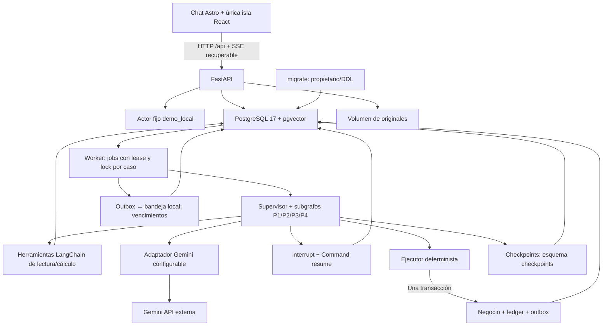

# Arquitectura implementada de la V1

Los diseños originales 1.2 se conservan en `docs/`; no existía una aplicación al iniciar el trabajo. Esta implementación usa las rutas reales del repositorio sin trasladar ni sustituir los BPMN. El producto se entrega en un monolito modular con tres servicios permanentes y una migración temporal.

## Capas y responsabilidades

| Módulo | Responsabilidad implementada |
|---|---|
| `domain` | Actor/alcance, reloj Lima inyectable, hashes, errores, siete campos, acciones permitidas y evidencia de cumplimiento; no importa IA, HTTP o DB |
| `application` | Puerto de proveedor/embeddings, fachada del ejecutor y presentación de resultados de negocio persistidos |
| `agents` | Supervisor, contratos Pydantic estrictos, políticas de sistema versionadas, cuatro prompts y herramientas restringidas por especialista |
| `graphs` | Estado tipado, supervisor, cuatro instancias de subgrafo con contratos/herramientas propios, política de preparación, pausa/reanudación y transmisión de respuesta validada |
| `infrastructure` | Única construcción de modelos en `llm/provider.py`, embeddings, validación/almacenamiento de medios, repositorios transaccionales, checkpointer, RAG y fuentes públicas |
| `interfaces/api` | FastAPI, identidad fija, DTO que prohíben campos extra, origen/host/tamaño, API de chat, archivos, casos, revisiones y evidencia |
| `workers` | Jobs persistentes, leases, heartbeat, ejecución/recuperación del grafo, outbox local, vencimientos sin falsa conformidad |
| `web` | Astro estático, React/TS/Tailwind/shadcn, estado único de conversación, SSE, adjuntos, revisiones e inspector |

Los especialistas no son respuestas prefijadas: invocan Gemini a través de LangChain y devuelven contratos diferentes. Comparten una fábrica de subgrafos; cada instancia tiene su prompt, schema y catálogo de lecturas. El grafo aplica reglas deterministas de suficiencia: datos P1 completos producen tarjeta y opciones P2 calculadas producen elección, sin confundir esa preparación con autorización o escritura.

La ruta también valida la fase: «programar un recojo» en un caso sin pedido inicia Atención, que pide los datos faltantes. Si el modelo sugiere P2 sin `order_id`, el backend deriva a P1 y verifica el permiso de Atención antes de invocar sus herramientas. Para modificar un pedido existente se solicita su vinculación explícita. La ausencia de pedido no se trata como un fallo técnico ni dispara reservas. El evento del supervisor conserva ruta propuesta y ruta efectiva.

## Autoridad y persistencia

`app.orders`, `customers`, `slots`, `reservations`, `cases`, `messages`, `approvals`, `operator_events`, `command_ledger`, `outbox`, `inbox`, `documents`, `chunks` y `collections` son la fuente de verdad. `reference` almacena fuentes históricas públicas externas. `checkpoints` contiene exclusivamente tablas del saver LangGraph.

El `thread_id` es `org:<organization_id>:case:<UUID>`. Un nuevo mensaje es un run persistido y deduplicado por ID/hash; una nueva conexión SSE solo consulta eventos. Cada caso tiene como máximo un job activo. Un lease vencido permite recuperar un trabajo tras un reinicio y un advisory lock de sesión evita dos ejecuciones simultáneas de ese caso. Un checkpoint completado, pendiente de respuesta o interrumpido se recupera según su estado; no se reinicia una escritura con otro identificador.

Las escrituras de negocio usan transacción y un ledger único `(organization_id, command_id)`. El pedido tiene `request_id` único. Capacidad y versiones se verifican bajo lock. El mismo comando con otro contenido produce conflicto. El resultado de commit incierto se resuelve consultando/reintentando el mismo comando, que devuelve el ledger confirmado. Outbox se registra en esa transacción; fallar la notificación conserva el pedido.

Las aprobaciones contienen propuesta/hash, versión de caso/pedido, rol, actor, decisión y política. Decidir una revisión, encolar su reanudación y registrar el evento público ocurre en una sola transacción; un conflicto de cola no consume la revisión. El fingerprint de límites de laboratorio invalida autorizaciones de otra configuración. Cambiar evidencia invalida propuestas; los eventos humanos también avanzan la versión del pedido vinculado. Antes de preparar una propuesta se verifica que el caso y pedido analizados sigan vigentes. Antes del efecto se verifica otra vez.

## RAG y medios

El corpus aprobado demo tiene cuatro documentos y 14 fragmentos. La ingesta obtiene vectores reales, normaliza L2, comprueba dimensión y persiste modelo/dimensión/hash. Colecciones diferentes no mezclan espacios vectoriales; un trigger verifica la dimensión y otro impide cambiar modelo/dimensión de una colección existente. Se usa similitud coseno exacta, suficiente para este corpus. Los filtros de acceso/vigencia se aplican en SQL.

Las referencias CPSC tienen otro esquema, procedencia, checksum y consulta. Sirven como contexto histórico, no como conocimiento interno autorizante. Una subida de cliente nunca se ingiere como procedimiento global.

Los medios se validan por contenido real y límites, guardan original/MIME/hash/caso y se analizan con el SDK Gemini. La transcripción/observación es editable y no constituye confirmación. Los checkpoints conservan referencias; ningún blob base64 se persiste en ellos. PDF permite referencias de página en la percepción. Los archivos se entregan por endpoints autorizados.

## Transporte y frontend

FastAPI sirve el build Astro y reserva `/api/`; una ruta API inexistente devuelve 404 JSON. El Dockerfile compila con Node y pnpm, y copia recursos al contenedor Python. No hay servidor Node permanente ni Vercel AI SDK.

Eventos públicos: run, agente, herramientas, resumen de decisión, revisión, inicio/deltas de mensaje y resultado. Incluyen secuencia, run/caso, fecha, modelo/prompt y duración/uso cuando están disponibles. No contienen pensamiento privado, claves o prompts del sistema. Las propuestas estructuradas se validan completas y su texto público se transmite en deltas SSE; no se retransmiten tokens JSON sin validar ni se reescribe consentimiento con otro LLM. El adaptador ofrece además `astream` nativo, comprobado separadamente por smoke/evaluaciones.

Sidebar 248 px, columna hasta 760 px e inspector 340 px; Sheet en móvil. Inter y JetBrains Mono empaquetadas localmente. Datos demo y capacidades indisponibles se identifican explícitamente. No hay selector de rol.

## Despliegue y límites

`db` debe estar saludable; `migrate` aplica migraciones versionadas y prepara el saver/privilegios; API/worker arrancan después. Solo `127.0.0.1:8000` se publica. Volúmenes `postgres` y `media` sobreviven a reinicios. API/worker usan un rol DB sin privilegios de propietario; los modelos y claves no se empaquetan en el frontend.

Esta V1 interpreta y coordina; no lava, inspecciona, transporta, paga ni acredita identidad de personas reales. n8n/Sheets, SMTP, SSO y despliegue en red quedan fuera del perfil implementado. Las políticas de laboratorio y la calidad del razonamiento se prueban, pero requieren ratificación/evaluación con datos autorizados antes de un piloto real.
