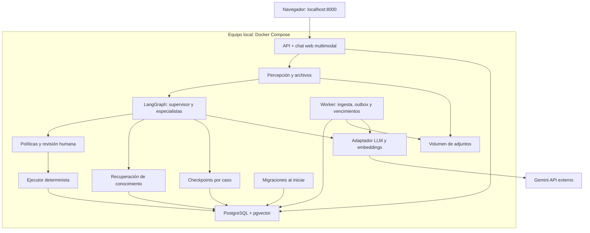

> Antecedente V1. Para el alcance vigente al detalle consultar README.md, docs/PLAN_ARQUITECTURA.md, docs/contratos/DETALLE_V2.md y docs/arquitectura/IMPLEMENTADA.md. Se conserva el texto histórico.

> Para el despliegue efectivamente implementado y verificado, consultar [IMPLEMENTADA.md](IMPLEMENTADA.md) y el [README de ejecución](../../README.md). Se conserva el diseño original a continuación.

# Despliegue local propuesto para la V1

Este es un diagrama de componentes y despliegue de software. Los procesos de negocio permanecen en BPMN 2.0; un diagrama de contenedores no se representa como si fuera un proceso de lavandería.

La API y el worker pueden usar la misma imagen con comandos de inicio diferentes. Los módulos internos dibujados no son contenedores independientes. Compose tiene tres servicios de larga duración y uno temporal para migraciones.

PostgreSQL guarda datos estructurados del negocio y chat. pgvector agrega recuperación por similitud sobre conocimiento aprobado. Los checkpoints conservan el progreso de cada caso. Los adjuntos se guardan en un volumen local compartido. Gemini queda fuera del equipo: una V1 local con este proveedor necesita conexión a internet.

El orden de inicio debe ser DB saludable, migraciones completas y luego API/worker. Las pruebas reales comprueban además la ingesta de vectores, el proveedor, la percepción multimodal y el flujo de negocio; no basta con ver contenedores activos.
