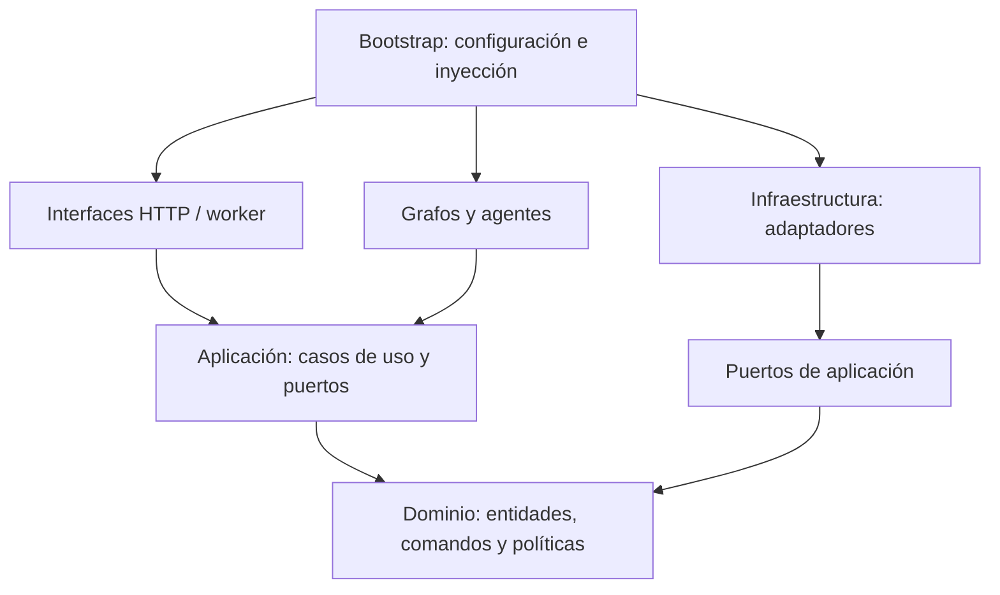

> Antecedente V1. Para el alcance vigente al detalle consultar README.md, docs/PLAN_ARQUITECTURA.md, docs/contratos/DETALLE_V2.md y docs/arquitectura/IMPLEMENTADA.md. Se conserva el texto histórico.

# Trazabilidad del negocio al software

| Decisión/actividad | AS IS de origen | TO BE | Responsable / módulo futuro | Aceptación planificada |
|---|---|---|---|---|
| Captura de solicitud | `T_Registrar` | `P1_Interpretar` y aclaraciones | Atención; `agents/attention.py` | A01–A02 |
| Habilitación comercial | `G_Habilitado`, `T_VerificarDeuda` | `P1_Validar`, `P1_Humano` | Política + administración | A05 |
| Registro por reglas | TO BE RPA `T_RegistrarPedido` | `P1_Registrar` | Ejecutor + adaptador n8n/Python | A03–A04 |
| Programación normal | `T_Programar` | `P2_Contexto`, `P2_Opciones` | Agenda determinista | A06 |
| Ropa no lista | `T_ReprogRecojo` | Retorno del integral a P2 | Logística + responsable humano | Cambio factible y acotado |
| Ausencia de receptor | `T_ReprogEntrega` | Retorno del integral a P2 | Logística + chofer | Sin afirmar entrega realizada |
| Inspección | `SP_VerificarCalidad` | `P3_Inspeccion`, `P3_Analizar` | Operario y calidad | A07 |
| Reproceso | `SP_Reprocesar` | `P3_Reproceso`, `P3_Verificar` | Personal de planta | Máximo piloto y resultado documentado |
| Daño/extravío | `BND_ErrorPrenda`, `SP_GestionarIncidencia` | `P3_Incidencia` → P4 | Calidad, incidencias y administración | A08–A09 |
| Observación posterior | `Msg_Obs`, `T_AtenderObs` | `Integral_Obs` → `Integral_P4C` | Asesor y agente de incidencias | Recepción aun después del cierre documental |
| Liberación del lote | Retorno de incidencia insuficientemente detallado | `P3_Registrar`, `Integral_Solucion` | Calidad + política | No empacar lote retenido |
| Cierre del pedido | `T_ArchivarGuia` | `Integral_Cerrar` | Administración | Guía y estado consistentes |
| Autorización de propuesta | Decisiones humanas en el AS IS | `Orquestacion_Revisar` | API de aprobación y `interrupt()` | A10–A13 |
| Espera sin respuesta | Temporizadores y esperas previas | Vencimientos P1/P2/P4 | Worker y checkpoint | A14 |

Los IDs del AS IS se conservan en la copia revisada. Los IDs TO BE permiten localizar la tarea dentro del XML. La especificación técnica se completa en las descripciones por proceso y en `PLAN_ARQUITECTURA.md`; no se declara una correspondencia automática de XML a código.

## Dependencia entre módulos

Este diagrama expresa dependencias de código. El diagrama de componentes del plan expresa comunicación en ejecución. El dominio no importa FastAPI, LangChain, LangGraph ni un cliente de hojas de cálculo.
